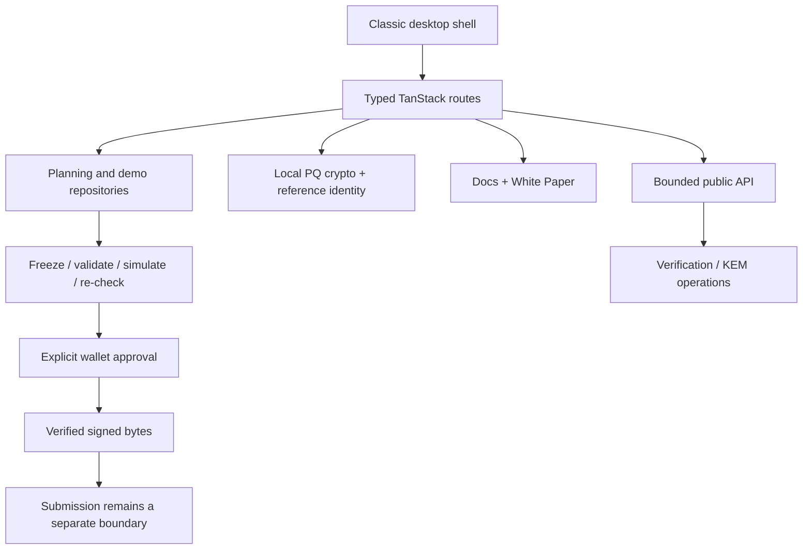

<p align="center">
  
</p>

<h1 align="center">Quantum QLi</h1>
<p align="center"><strong>Quantum liquidity, under control.</strong></p>
<p align="center">
  <a href="https://github.com/QuantumQLi/QuantumQLi/actions/workflows/ci.yml"></a>
  <a href="https://github.com/QuantumQLi/QuantumQLi/actions/workflows/security.yml"></a>
  
  
</p>

Quantum QLi is a **non-custodial Solana liquidity and cryptography workspace** presented as a classic desktop operating environment. It combines Meteora DBC launch planning, explicit wallet transaction review, reference identity proofs, local post-quantum cryptography, market research surfaces, technical documentation, and a first-party technical white paper.

> [!IMPORTANT]
> Quantum QLi does **not** claim that Solana is post-quantum secure. Solana account and transaction authorization continues to use the network’s existing signature model. Post-quantum functionality in this repository is an application-layer workbench/reference system and a research direction for future authorization models.

## What is implemented

| Workspace | Current implementation |
| --- | --- |
| **QLi Desk** | Crypto workbench, service checks, session overview and operational telemetry |
| **QLi Operator** | Deterministic strategy planning with Observe/Guarded modes; Autonomous is scheduling preview only |
| **Launch Forge** | Seven-stage Meteora DBC launch planning targeting DAMM v2 migration |
| **Liquidity Chambers / Inventory / Revenue** | Explicitly labeled demo pool, position and fee tooling |
| **Quantum Identity** | Reference WOTS/Merkle identity construction with one-time leaf tracking |
| **Proof Inspector** | Public proof/signature inspection and verification tooling |
| **Portfolio / Vault** | Connected-wallet RPC reads and local cryptographic workflows |
| **API Desk** | Bounded public cryptographic endpoints; no private-key or custodial signing API |
| **Help / White Paper** | 27 technical guides plus the versioned technical white paper |

## Architecture



The application uses React 19, TypeScript, TanStack Start/Router/Query, Vite, Tailwind CSS, Nitro, Solana Web3, Meteora Dynamic Bonding Curve SDK, and Noble post-quantum primitives.

## Security model

- **Non-custodial by design.** Quantum QLi does not hold wallet keys or silently sign transactions.
- **Review is distinct from execution.** A launch review is not token deployment; a signed identity anchor is not a submitted or confirmed public timestamp.
- **Real local PQ primitives.** The workbench exposes ML-DSA-65, SLH-DSA-SHA2-128s and ML-KEM-768 locally.
- **Reference WOTS/Merkle identity.** One-time leaf usage is tracked locally; the ledger is not a globally synchronized anti-reuse service.
- **No false production claims.** Demo rows are not wallet holdings. There is no unattended production trading signer or deployed post-quantum custody verifier.
- **Secret hygiene.** `.env` files are ignored. Only empty environment-variable names belong in `.env.example`.

Read **[SECURITY.md](SECURITY.md)** and **[dependency security status](docs/DEPENDENCY_SECURITY.md)** before changing trust boundaries.

## Quick start

**Requirements:** Node.js 22+ and Bun 1.3.3+.

```bash
bun install --frozen-lockfile
bun run dev
```

Then open `http://localhost:8080`.

### Quality gates

```bash
bun run format:check
bun run lint
bun run typecheck
bun run test
bun run build
bun run check:repository
bun run audit:dependencies
```

The current verified source snapshot passes **55 tests**, production build, repository-hygiene checks, and lint with **0 errors / 0 warnings**. The dependency audit reports **0 advisories at any severity** and does not suppress findings.

## Documentation

- **[Technical White Paper](docs/whitepaper/index.md)** — system model, cryptography, trust boundaries and roadmap
- **[Quick Start](docs/quick-start.md)** — first session and safe exploration
- **[Architecture](docs/architecture.md)** — code and trust-boundary map
- **[Security](docs/security.md)** — protocol and application security model
- **[Wallet flow](docs/wallet-flow.md)** — review, signing and submission boundaries
- **[Post-quantum model](docs/post-quantum.md)** — implemented algorithms vs research scope
- **[Solana + Meteora DBC](docs/solana-meteora.md)** — protocol concepts used by the application
- **[Known limitations](docs/limitations.md)** — demo/adaptor boundaries and unsupported claims

The in-app readers are available at `/docs` and `/whitepaper`.

## Repository standards

- Pull requests run CI, type/build checks, tests, repository-hygiene validation and security checks.
- Dependabot tracks GitHub Actions updates; Bun dependencies are covered by the scheduled first-party advisory audit and reviewed updates.
- CodeQL and the first-party dependency audit are configured without repository secrets.
- Contribution rules: [CONTRIBUTING.md](CONTRIBUTING.md)
- Code of conduct: [CODE_OF_CONDUCT.md](CODE_OF_CONDUCT.md)
- Release process: [RELEASE.md](RELEASE.md)
- Changelog: [CHANGELOG.md](CHANGELOG.md)
- Support: [SUPPORT.md](SUPPORT.md)

## Roadmap

The roadmap is directional rather than a delivery promise:

1. Verification hardening
2. Transaction completeness
3. Identity coordination
4. Production data adapters
5. Post-quantum authorization research

See [roadmap.md](roadmap.md) for implementation-level status.

## License status

The repository is publicly visible, but **no source-code license grant is currently provided**. See [LICENSE](LICENSE) and [docs/LICENSING.md](docs/LICENSING.md). Third-party dependencies and artwork remain subject to their respective rights.

---

<p align="center"><strong>Quantum QLi</strong> · inspectable tools, explicit boundaries, wallet-controlled execution.</p>
