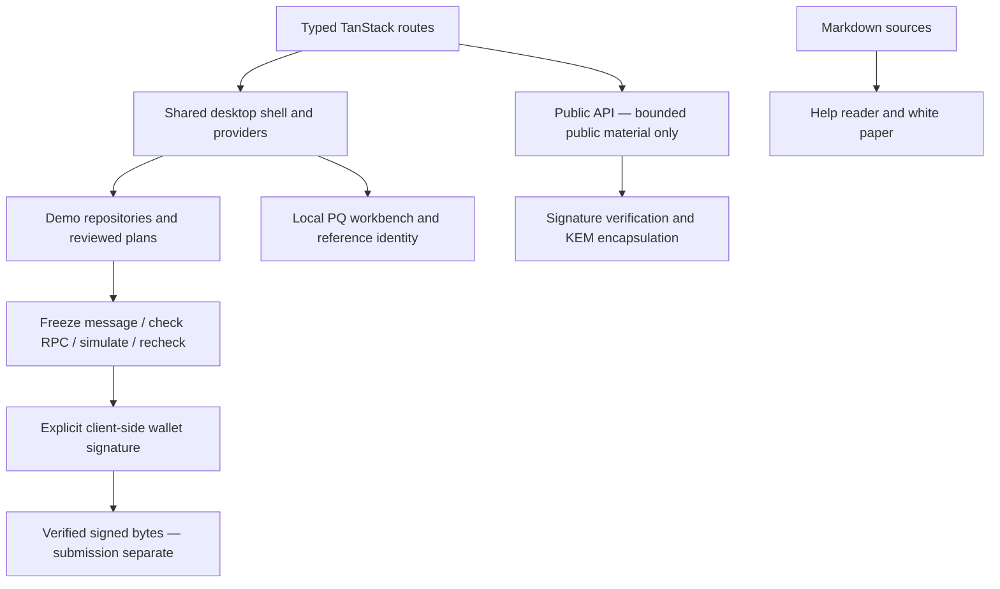

# Quantum QLi


**Quantum liquidity, under control.**

[](https://github.com/QuantumQLi/QLi/actions/workflows/ci.yml)
[](https://github.com/QuantumQLi/QLi/actions/workflows/security.yml)
[](docs/LICENSING.md)

Workflow badges show GitHub's actual status, not a claim of a completed hosted run. CI includes the full test suite; security checks are not an independent audit.

Quantum QLi is a non-custodial Solana liquidity planning and cryptography workspace presented as a classic desktop. It combines a Meteora DBC launch planner, explicit transaction review, reference identity proofs, real local post-quantum operations and clearly labeled market simulations. The product is independently implemented; see [reference inventory](reference-audit.md).

## Modules

Hook Forge v2.3 owner activation: checksum-verified deployment, public read-only verification and an explicitly approved local E2E harness. Start with `bash scripts/e2e-hook-dbc-devnet.sh --help`; no default spending, no automatic migration, no public deployment claimed. See [owner runbook](docs/HOOK_FORGE_DEVNET.md) and [migration blocker #17](https://github.com/QuantumQLi/QLi/issues/17).

| Workspace                                | Implementation                                                                                           |
| ---------------------------------------- | -------------------------------------------------------------------------------------------------------- |
| QLi Desk / QLi Operator                  | Session overview, strategies and Observe/Guarded modes; Autonomous is scheduling preview only            |
| Launch Forge                             | Asset → Curve → Fees → Migration → Quote Market → First Buy → Review; DAMM v2 only                       |
| Liquidity Chambers / Inventory / Revenue | Explicit demo pool, position and fee views; not live wallet holdings                                     |
| Quantum Identity / Proof Inspector       | Reference WOTS-16, SHA-256, height-8 Merkle construction and one-time leaf tracking                      |
| Markets / Trending / Terminal / Explore  | Public research surfaces and safe demo adapter boundary                                                  |
| Portfolio / Vault surfaces               | Connected-wallet RPC reads, local cryptographic workbench and verifier readiness; no deployed PQ custody |
| API Desk / Event Log / System            | Bounded public crypto APIs, events and session configuration                                             |
| Help / White Paper                       | 27 technical articles and versioned 20-section reader with Print / Save PDF                              |

## Architecture



React 19, TypeScript, TanStack Start/Router/Query, Vite, Tailwind CSS and build-only Nitro form the application stack. Direct plugins target a Worker runtime; Solana browser aliases and the custom SSR entry remain explicit. See [architecture/code map](docs/architecture.md).

## Security boundaries

- Wallet approval remains explicit. Signing verifies the frozen review, fee payer, RPC genesis and blockhash, simulates without replacement and validates returned signed bytes. It does not submit.
- ML-DSA-65, SLH-DSA-SHA2-128s and ML-KEM-768 are real local operations. They do **not** upgrade Solana's existing account/transaction signature model. PQ on-chain authorization is research, not implemented custody.
- Quantum Identity is a reference WOTS/Merkle construction. Its used-leaf ledger is browser-local, not globally synchronized across devices/tabs. JavaScript cannot guarantee erasure of every secret buffer.
- Launch review is **not token deployment**. The current launch digest does **not** bind all curve, fee, social-link or first-buy settings; a valid seal is not approval of every economic input.
- Demo rows are not live holdings. Only explicitly connected-wallet Portfolio/RPC reads represent wallet data. An identity anchor may be signed but not submitted; that is not public confirmation.
- No background trading signer, custodial API or deployed quantum vault verifier exists. Public service history may be volatile. Public API bodies are limited to 64 KB.

Read [SECURITY.md](SECURITY.md) before changing trust boundaries. No governance token, sale, revenue-sharing instrument, investment product or guaranteed return is defined.

## Quick start

Use Node.js 22+ and Bun 1.3.3:

```sh
bun install --frozen-lockfile
bun run dev
```

Open http://localhost:8080. Public/demo tools do not require backend credentials. Optional browser auth configuration uses the names in `.env.example`; configure actual values outside Git and never prefix private secrets with `VITE_`.

```sh
bun run format:check
bun run lint
bun run typecheck
bun run test
bun run build
bun run check:repository
```

`bun run format` applies formatting; `bun run test:watch` watches tests. Production output is `dist/client` plus `dist/server`, not a static-only deployment. Deployment and release are separate from building.

## Documentation and contributions

- [Technical docs source](docs/welcome.md) · in-app `/docs`
- [Technical White Paper v0.1](docs/whitepaper/index.md) · in-app `/whitepaper`
- [Local development](docs/local-development.md) · [deployment](docs/deployment.md)
- [Contributing](CONTRIBUTING.md) · [architecture guidance](AGENTS.md) · [conduct](CODE_OF_CONDUCT.md)
- [Release checklist](RELEASE.md) · [changelog](CHANGELOG.md) · [roadmap](roadmap.md)
- [Repository metadata suggestions](docs/REPOSITORY.md) · [licensing status](docs/LICENSING.md)
- [GitHub account](https://github.com/QuantumQLi) · [X](https://x.com/QuantumQLi)

No source license has been selected; public visibility is not a license grant. Third-party dependencies and artwork retain their respective rights. Do not describe this repository as permissively licensed until maintainers decide.

## Launch Proof Engine (v1)

`/launch-proofs` verifies a Meteora DBC launch from Solana RPC evidence (genesis, confirmed status, DBC pool creation, DBC-owned pool and config, PDA derivation, signed creator) and issues a tamper-evident receipt. The digest is a local integrity checksum, not a signed or on-chain attestation. Read-only; see `docs/LAUNCH_PROOF_ENGINE.md`.

## Meteora Lifecycle Intelligence (v2)

`/meteora-intelligence` inspects any Meteora DBC pool read-only: verified graduation state, exact SDK `swapQuote2` estimates, fee accrual and a bounded event timeline, plus a public JSON API at `/api/public/meteora/v1/pools/{network}/{pool}`. See `docs/METEORA_LIFECYCLE_INTELLIGENCE.md`.

## Quantum Authorization (v1)

Opt-in, application-level WOTS/Merkle authorization intents bound to exact reviewed Flywheel transactions (`/authorization`). Not on-chain enforced; other clients and directly signed transactions can bypass it. Your wallet still approves every transaction.

## QLi Agent

`/qli-agent` is a session-only, read-only observer for your own Meteora DBC pools with deterministic alerts and non-executable Flywheel proposals. Every transaction still requires fresh wallet review and approval; Quantum Authorization is application-enforced, not on-chain protection. See `docs/qli-agent.md`.

### QLi Agent v2

Wallet-signed sign-in, backend-stored monitoring of up to 5 creator-owned pools, a 5-minute scheduled read-only worker, persisted alerts/proposals and the QLi Data Engine (`docs/qli-data-engine.md`). The worker never moves funds.

## Quantum Vault Protocol (Phase 1)

`programs/quantum_vault` is an unaudited Anchor program for policy-limited SPL Token escrow; `/quantum-vault` shows it with writes disabled (devnet not deployed). Genuine SBF build and local compiled-program SPL CPI tests passed; no public deployment or owner-controlled signer was available. The spend window is fixed, not sliding; no rent/signer recovery. See `docs/quantum-vault-protocol.md`.

## Agentic Creator Studio

`/creator-studio` drafts original AI-character media packs grounded in verified Meteora DBC evidence. Drafting only; see [docs/CREATOR_STUDIO.md](docs/CREATOR_STUDIO.md).

## QuantumQLi Hook Forge

`/hook-forge` designs Meteora DBC native fee/curve/migration policies and inspects Token-2022 transfer hooks (token transfer callbacks, not swap callbacks). Read-only, no signing. See [docs/HOOK_FORGE.md](docs/HOOK_FORGE.md).

## Hook Forge v2

Research Token-2022 transfer hook and devnet `/hook-proofs` verifier. Locally tested only; not deployed or audited. See [docs/HOOK_FORGE_V2.md](docs/HOOK_FORGE_V2.md).

### Hook Forge v2.1 devnet console

`/hook-devnet` creates and tests a hook-bound Token-2022 mint on devnet with wallet approval once you deploy the research hook. See [docs/HOOK_FORGE_DEVNET.md](docs/HOOK_FORGE_DEVNET.md).

## Network testing

See `/network-lab` and [docs/NETWORK_TEST_CENTER.md](docs/NETWORK_TEST_CENTER.md) for the read-only Devnet/Mainnet readiness lanes, owner test guide and blockers.