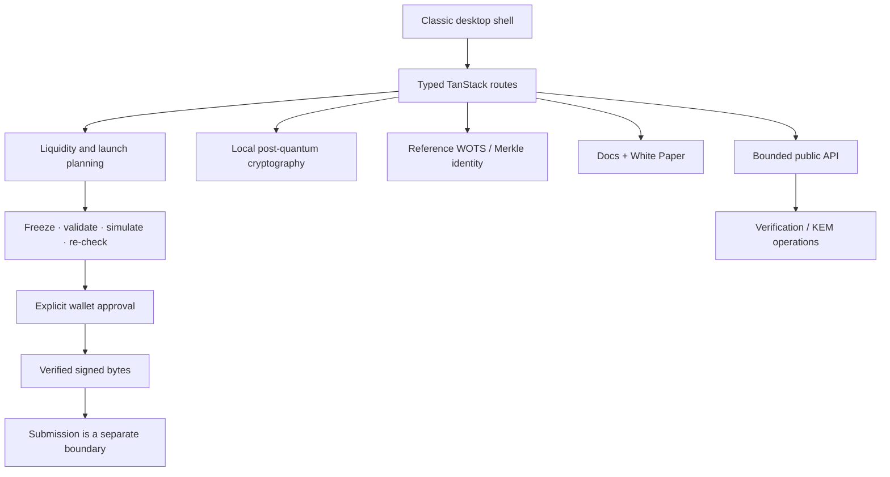

<p align="center">
  
</p>

<h1 align="center">Quantum QLi</h1>
<p align="center"><strong>Quantum liquidity, under control.</strong></p>
<p align="center">
  A non-custodial Solana liquidity command desk combining Meteora DBC launch planning,
  wallet-controlled transaction review, identity proofs, proof verification and local post-quantum cryptography.
</p>

<p align="center">
  <a href="https://github.com/QuantumQLi/QuantumQLi/actions/workflows/ci.yml"></a>
  <a href="https://github.com/QuantumQLi/QuantumQLi/actions/workflows/security.yml"></a>
  <a href="https://github.com/QuantumQLi/QuantumQLi/actions/workflows/codeql.yml"></a>
  <a href="https://github.com/QuantumQLi/QuantumQLi/actions/workflows/scorecard.yml"></a>
  
  
  <a href="LICENSE"></a>
</p>

> [!NOTE]
> **Status:** active development, pre-1.0. The current verified snapshot passes 59 tests, type checking, production build, repository-hygiene checks, lint with 0 errors / 0 warnings, and a dependency audit with 0 advisories at any severity.

## Why Quantum QLi

Liquidity tooling often splits launch configuration, wallet review, market context, cryptographic verification and operational documentation across unrelated interfaces. Quantum QLi brings those workflows into a single inspectable desktop-style environment with explicit trust boundaries.

The project is primarily an **application-layer system**. A custom on-chain program is not required for its implemented local cryptography, proof verification, connected-wallet RPC reads or launch-planning workflows. Any transaction that reaches a wallet remains subject to explicit user review and signing.

## Repository health

| Check | Current verified state |
| --- | --- |
| Test suite | **59 passing** |
| ESLint | **0 errors · 0 warnings** |
| Type checking | **Clean** |
| Production build | **Passing** |
| Dependency audit | **0 critical · 0 high · 0 moderate · 0 low** |
| Repository hygiene | **Passing** |
| Vendor-name scan | **0 matches** |
| CI / security automation | **Configured** |

See [Dependency Security](docs/DEPENDENCY_SECURITY.md), [Security Policy](SECURITY.md), and the [Feature Matrix](docs/FEATURE_MATRIX.md) for evidence and scope.

## Core capabilities

| Workspace | Capability |
| --- | --- |
| **QLi Desk** | Cryptography workbench, system health, session overview and operational telemetry |
| **QLi Operator** | Deterministic strategy planning with explicit guardrails and wallet-controlled review |
| **Launch Forge** | Seven-stage Meteora Dynamic Bonding Curve planning targeting DAMM v2 migration |
| **Portfolio / Vault** | Connected-wallet RPC reads plus local cryptographic workflows |
| **Quantum Identity** | Reference WOTS/Merkle identity construction with one-time leaf tracking |
| **Proof Inspector** | Signature/proof inspection and verification |
| **Liquidity Chambers / Inventory / Revenue** | Structured liquidity research and reference datasets |
| **API Desk** | Bounded public cryptographic endpoints with no private-key or custodial signing surface |
| **Help / White Paper** | First-party technical documentation and a versioned technical white paper |

### Implemented post-quantum primitives

The local workbench exposes:

- **ML-DSA-65**
- **SLH-DSA-SHA2-128s**
- **ML-KEM-768**

These are application-layer cryptographic tools. Quantum QLi does **not** claim that Solana's current account or transaction authorization is post-quantum secure.

## Architecture



**Stack:** TypeScript · React 19 · TanStack Start/Router/Query · Vite · Tailwind CSS · Nitro · Solana Web3 · Meteora Dynamic Bonding Curve SDK · Noble post-quantum cryptography · Supabase integration support · Vitest

## Quick start

**Requirements:** Node.js 22+ and Bun 1.3.3+.

```bash
git clone https://github.com/QuantumQLi/QuantumQLi.git
cd QuantumQLi
bun install --frozen-lockfile
bun run dev
```

Open `http://localhost:8080`.

### Run the complete quality gate

```bash
bun run format:check
bun run lint
bun run typecheck
bun run test
bun run build
bun run check:repository
bun run audit:dependencies
```

## Documentation

- **[Technical White Paper](docs/whitepaper/index.md)** — system model, trust boundaries, cryptography and roadmap
- **[Feature Matrix](docs/FEATURE_MATRIX.md)** — implemented, wallet-backed, planning and research/reference surfaces
- **[Quick Start](docs/quick-start.md)** — first session
- **[Architecture](docs/architecture.md)** — code and trust-boundary map
- **[Security](docs/security.md)** — protocol and application security model
- **[Wallet Flow](docs/wallet-flow.md)** — review, signing and submission boundaries
- **[Post-Quantum Model](docs/post-quantum.md)** — implemented algorithms vs research scope
- **[Solana + Meteora DBC](docs/solana-meteora.md)** — protocol concepts used by the application
- **[Known Limitations](docs/limitations.md)** — explicit unsupported or incomplete surfaces

The in-app readers are available at `/docs` and `/whitepaper`.

<details>
<summary><strong>Security and scope boundaries</strong></summary>

- Quantum QLi is non-custodial and does not hold wallet private keys.
- Launch review is planning and validation; it is not the same thing as token deployment.
- The QLi Operator's autonomous mode is a scheduling preview, not an unattended production signer.
- WOTS/Merkle one-time-leaf tracking is local to the browser environment and is not globally synchronized.
- JavaScript cannot guarantee secure erasure of every secret buffer.
- Reference liquidity rows are clearly separated from connected-wallet RPC portfolio data.
- Identity anchor states distinguish signed bytes from submission and confirmation.

</details>

## Repository engineering

This repository includes:

- CI for format, lint, typecheck, tests, production build and repository-hygiene checks
- scheduled dependency/security auditing
- CodeQL static analysis
- OpenSSF Scorecard automation
- Dependabot configuration
- CODEOWNERS, issue templates and pull-request templates
- CONTRIBUTING, SECURITY, SUPPORT, CHANGELOG and release-process documentation
- a first-party compatibility contract and security-focused dependency notes

GitHub-native dependency review can be enabled after the repository's Dependency graph setting is turned on. Until then, the first-party lockfile audit remains the enforced dependency-security check.

## Contributing

Start with [CONTRIBUTING.md](CONTRIBUTING.md). Security-sensitive findings should follow [SECURITY.md](SECURITY.md), not a public issue.

## Roadmap

The roadmap is directional rather than a delivery promise:

1. Verification hardening
2. Transaction completeness
3. Identity coordination
4. Production data adapters
5. Post-quantum authorization research

See [roadmap.md](roadmap.md).

## License

Quantum QLi source code and project documentation are licensed under the **Apache License 2.0**. See [LICENSE](LICENSE) and [docs/LICENSING.md](docs/LICENSING.md).

The Quantum QLi name, logos, trademarks and original visual artwork are **not** granted under Apache-2.0 unless a file explicitly says otherwise. Third-party dependencies and assets remain subject to their respective licenses and rights.

---

<p align="center"><strong>Quantum QLi</strong> · inspectable infrastructure, explicit boundaries, wallet-controlled execution.</p>
